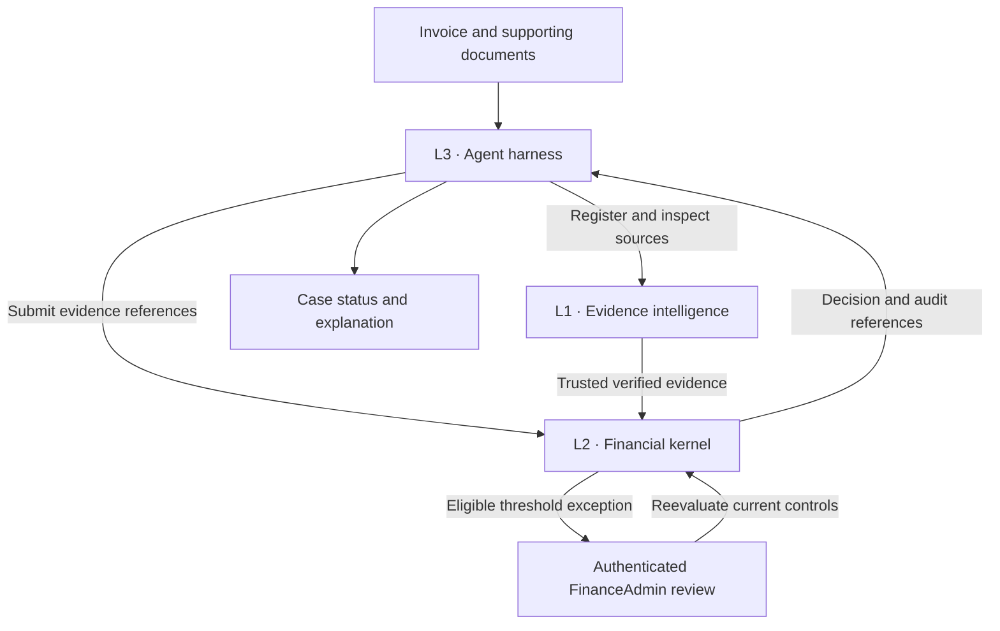

# Praeco

**An AI teammate for governed accounts payable.**

Praeco coordinates invoice intake, source-backed evidence, deterministic financial checks, and human review. Its specialists prepare and explain work; a dedicated financial kernel decides whether a payable qualifies for simulated authorization.

Built for the **30X Hackathon · Blinka Challenge**. The demo uses fictional companies, vendors, invoices, and fixed exchange rates. **No real money moves.**

## How it works

Praeco separates operational work, documentary evidence, and financial authority into three layers.



| Layer | Responsibility | Boundary |
| --- | --- | --- |
| **L1 · Evidence intelligence** | Parse documents, ground extracted facts in retained sources, verify citations, and normalize amounts | Readiness establishes documentary evidence, not permission to spend |
| **L2 · Financial kernel** | Apply six deterministic gates, enforce duplicate and budget controls, record decisions, and resolve approvals | Sole financial authority |
| **L3 · Agent harness** | Coordinate specialists, cases, assignments, checkpoints, channel identities, and outcome notifications | Operational memory and conversations cannot override L2 |

Document classification proposes packet boundaries. L1 validates evidence within those boundaries; L2 independently evaluates the payable. See the [classification adapter](packages/document-classification-adapter/README.md).

### Product discovery

The living [AI Teammates learning specification and handoff](docs/product/ai-teammates-learning-handoff.md) (Spanish) records reference-app observations, proposed Praeco changes and acceptance criteria as we test the experience. It complements the architecture contracts and ADRs.

For the new workspace, see the [OpenCode execution brief](docs/product/opencode-execution-brief.md), the [technical baseline](docs/product/workspace-baseline.md) and the [delivery/review protocol](docs/product/orchestration-review.md).

### Financial outcomes

| Outcome | Meaning |
| --- | --- |
| `AUTHORIZED_SIMULATED` | The payable passed the applicable controls; no funds were transferred |
| `PENDING_HUMAN_APPROVAL` | An eligible threshold exception needs authenticated review |
| `BLOCKED` | A financial control prevents authorization |

The six gates check evidence integrity, duplicates, beneficiary and account eligibility, contract terms, period budget, and delegated auto-approval limits. Human approval cannot override a hard failure.

## Try the demo

Use **Node.js 22.12+** and npm. From the repository root:

```bash
npm ci
npm run check
npm run demo
```

The default demo runs offline with deterministic synthetic inputs. It covers eight cases: a contractor invoice, a recurring SaaS bill, an above-threshold agency invoice, a contract mismatch, a forwarded duplicate, an unknown beneficiary, insufficient budget, and a changed bank account.

`npm run test:l2` exercises the decision kernel, transactional semantics, human-approval lifecycle and a trusted L1 `reader.loadReady` integration against a real synthetic PDF. `npm run l2:demo` evaluates the eight canonical Blinka scenarios through the six gates and demonstrates one simulated FinanceAdmin approval. The L2 store is an in-process synthetic ledger for the hackathon, not the SQL-backed authoritative store required by ADR-003, and no real payments are ever made: `AUTHORIZED_SIMULATED` never means `PAID`.

## Run the workspace

Run `npm run web:workspace` and open `http://localhost:3010`. The workspace currently provides the UI frame, programmed synthetic conversations and optional Clerk access. See its [setup and limitations](apps/finance-workspace/README.md).

### Development commands

| Command | Purpose |
| --- | --- |
| `npm run check` | Build, typecheck, and run workspace tests |
| `npm run l1:demo` | Process an offline synthetic invoice through L1 |
| `npm run test:l1:integration` | Test external documentary intake and provenance |
| `npm run test:l2` | Test financial gates and approval behavior |
| `npm run test:l3` | Test orchestration, channel adapters, and recovery behavior |

PostgreSQL suites require a disposable database and otherwise skip. Follow the [SQL store guide](packages/financial-store-sql/README.md). Hosted document processing is opt-in; configuration lives in the [L1 runtime guide](docs/architecture/l1-runtime.md).

## Packages

| Package or app | Purpose |
| --- | --- |
| [Evidence intelligence](packages/evidence-intelligence/README.md) | Source registry, extraction, verification, and normalization |
| [Document classification](packages/document-classification-adapter/README.md) | DocJev/Jev packet segmentation and L1 extraction adapter |
| [External document intake](packages/external-document-intake/README.md) | External object revisions and documentary provenance |
| [Financial decision kernel](packages/financial-decision-kernel/README.md) | Deterministic policies, approvals, and financial outcomes |
| [Financial SQL store](packages/financial-store-sql/README.md) | Atomic successful commitments and durable result recovery |
| [Agent harness](packages/agent-harness/README.md) | Specialists, orchestration, channel adapters, and operational storage |

## Current scope

- L1, L2, and L3 are integrated in synthetic tests. These tests do not establish real-world extraction accuracy or production readiness.
- PostgreSQL adapters exist for L3 operational state and L2 successful commitments. L2 pending approvals, non-commit decisions, trusted financial context, and transactional outbox are not fully persisted.
- Workflow execution remains in-process. PostgreSQL storage does not by itself provide a deployed, cross-process durable workflow engine; Trigger.dev integration remains future work.
- Email, AgentMail, web, and linked Telegram adapters are library components. Live provider authentication, attachment transport, and the complete deployed operator journey still require validation. The AI tool bridge is exercised through scripted loops; live Vercel AI SDK execution is not established.
- OCR-assisted documents remain review-only. Independent field-level accuracy evaluation and validation of the current hosted citation policy remain outstanding.

## Architecture and contribution

Read the [solution design](docs/architecture/solution-design.md), [architecture decisions](docs/adr), and [contribution guide](docs/CONTRIBUTING.md). Package READMEs describe current entry points; detailed contracts and evaluation evidence live under [`docs/`](docs).

Licensed under [MIT](LICENSE).
