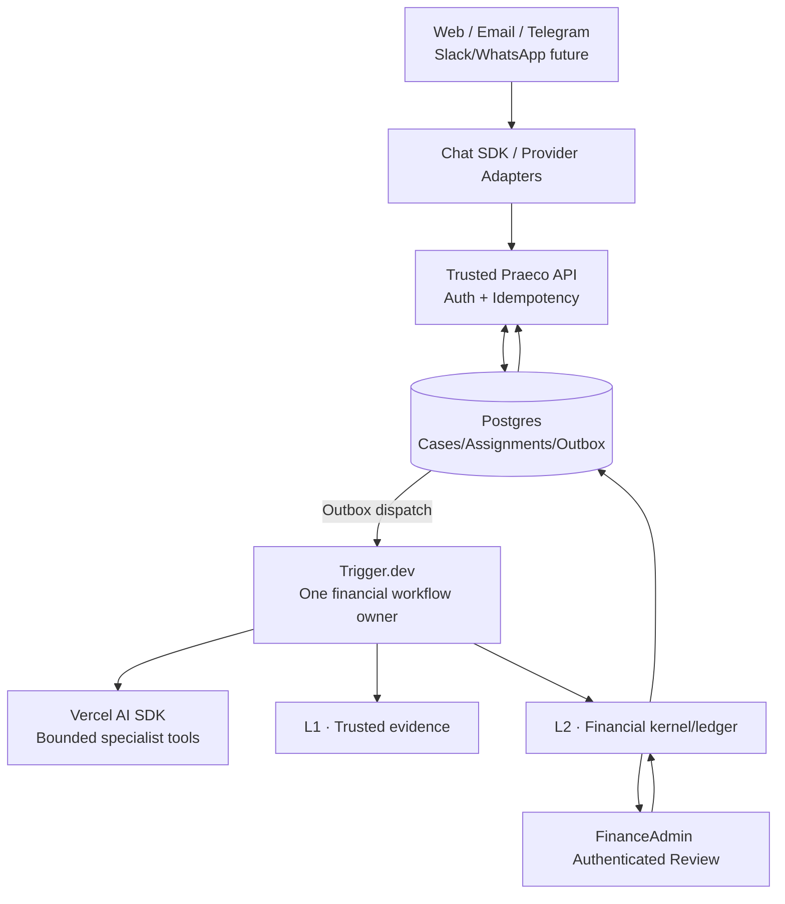

# L3 — Implementation Contract: Persistent Financial AI Teammate

**Status:** Implementation baseline; slice A (operational schema, idempotency, fencing) implemented, slices B–F in progress
**Date:** 2026-10-17
**Authoritative references:** ADR-001–007, L1 v3.0.0 wire contract, L2 implementation contract and eight golden scenarios
**Build order:** P0 Trigger.dev + Vercel AI SDK, Web/Email with optional Telegram adapter; P1 full Chat SDK multichannel; P2 Link and sandboxes only if justified. Eve and Pi Durable are outside this baseline; reconsideration requires a new ADR.

**P0 demo runtime (ADR-007):** For the hackathon demo, L3 runs on explicit in-process deterministic stand-ins behind the `HarnessStore` and workflow-driver ports — see [ADR-007](../adr/007-in-process-demo-runtime.md). This is a labeled deviation from the Trigger.dev/Neon production composition, not a claim of durability. Slices B–F are bound by ADR-007's exit-criteria deltas: offline deterministic tests with scripted model responses (no network or live keys in CI), all eight Blinka scenarios through real L1 processing including case 04's two-source case, resolve-before-subscribe on every wait, no surface printing "PAGÓ", and direct exact-byte email intake until Chat SDK email support is validated.

## 1. Product acceptance

The user can send one synthetic invoice by web or email, receive a durable Assignment, inspect L1 verification and source references, submit the same case through L2's six deterministic gates, see its decision and simulated budget effect, and request authenticated human approval for the one threshold-eligible golden case. Telegram can query/status or submit the same case only after identity linking. All provider/payment identifiers are synthetic. No real payments.

A successful output uses `AUTHORIZED_SIMULATED`, `BLOCKED` or `PENDING_HUMAN_APPROVAL` **only as returned by L2**. L3 operational status is independently typed.

## 2. Architecture and authority



The SQL arrow from L2 is conceptual **L2-owned tables and transactions**, not a permission for L3 or model tools to write the ledger. No Eve runtime in this graph. Provider callback signatures, tenancy and access control are checked before any command.

## 3. Proposed TS domain interfaces

The following contracts are design proposals; verify package APIs against installed versions in the implementation PR. Avoid importing actual Trigger or Chat SDK types into domain packages.

```ts
import type { ReadyEvidence } from "@praeco/evidence-intelligence";

type TenantId = string;
type AssignmentId = string;
type PayableCaseId = string;
type L1EnvelopeId = string;
type L2DecisionId = string;
type SpecialistRole = "VERA" | "KAEL" | "NOVA";
type FinancialOutcome = "AUTHORIZED_SIMULATED" | "BLOCKED" | "PENDING_HUMAN_APPROVAL";
type AssignmentState =
  | "QUEUED" | "RUNNING" | "WAITING_FOR_REVIEW"
  | "COMPLETED" | "FAILED_RECOVERABLE" | "FAILED_TERMINAL" | "CANCELLED";

interface TrustedPrincipal {
  tenantId: TenantId;
  principalId: string;
  roles: readonly string[];
  bindingRevision: string;
}
interface ChannelScope {
  provider: "WEB" | "EMAIL" | "TELEGRAM" | "SLACK" | "WHATSAPP";
  installationId: string;
}
interface InboundMessageCommand extends ChannelScope {
  providerEventId: string;
  providerUserId: string;
  providerThreadId: string;
  messageId: string;
  payloadDigest: string;
  text?: string;
  attachmentRefs: readonly string[];
}
interface AgentPrincipal {
  tenantId: TenantId;
  principalId: string;
  enabled: boolean;
}
interface TrustedExecutionContext {
  principal: TrustedPrincipal;
  assignmentId: AssignmentId;
  workerPrincipalId: string;
  workerVersionId: string;
  runId: string;
  ownershipEpoch: number;
}
type EvidenceRunReference = {
  sourceId: string;
  sourceHashSha256: string;
  pipelineRunId: string;
  externalBindingId?: string;
} & (
  | { sourceDisposition: "SUPPLEMENTAL_CONTEXT"; envelopeIds: readonly [] }
  | { sourceDisposition: "INVOICE_OR_UNCERTAIN"; envelopeIds: readonly [L1EnvelopeId, ...L1EnvelopeId[]] }
);
type CaseSourceLink =
  | { kind: "DOCUMENT"; evidence: EvidenceRunReference }
  | { kind: "ERP_REFERENCE" | "CHANNEL_MESSAGE"; refId: string };
interface PayableCase {
  caseId: PayableCaseId;
  tenantId: TenantId;
  sourceLinks: readonly CaseSourceLink[];
  version: number;
}
interface Assignment {
  assignmentId: AssignmentId;
  tenantId: TenantId;
  caseId: PayableCaseId;
  agentPrincipalId: string;
  requestedByPrincipalId: string;
  state: AssignmentState;
  version: number;
  activeRunId?: string;
  ownershipEpoch: number;
  cancellationRequestedAt?: string;
  pendingFinancialIntentId?: string;
  initialL2DecisionId?: L2DecisionId;
  latestL2DecisionId?: L2DecisionId;
  l2ApprovalRequestId?: string;
  triggerWaitToken?: string;
}
interface AgentRun {
  tenantId: TenantId;
  assignmentId: AssignmentId;
  runId: string;
  triggerRunId: string;
  workerVersionId: string;
  specialistRole?: SpecialistRole;
  ownershipEpoch: number;
}
interface Checkpoint {
  tenantId: TenantId;
  checkpointId: string;
  assignmentId: AssignmentId;
  runId: string;
  ownershipEpoch: number;
  stage: "INGESTED" | "EVIDENCE_RESOLVED" | "L2_INTENT_RECORDED" | "L2_DECISION_RECORDED" | "AWAITING_REVIEW" | "FINISHED";
  inputRefs: readonly string[];
  outputRefs: readonly string[];
  recordedAt: string;
}
interface ExecutionEvent {
  eventId: string;
  tenantId: TenantId;
  aggregateId: string;
  aggregateVersion: number;
  eventType: string;
  commandId: string;
  causationId?: string;
  payloadRef?: string;
  occurredAt: string;
}
interface FinancialIntentReference {
  intentId: string;
  assignmentId: AssignmentId;
  caseId: PayableCaseId;
  caseVersion: number;
  requestedByPrincipalId: string;
  workerPrincipalId: string;
  requestedBudgetId: string;
  envelopeIds: readonly [L1EnvelopeId, ...L1EnvelopeId[]];
  idempotencyKey: string;
  payloadDigest: string;
}
interface FinancialDecisionReference {
  decisionId: L2DecisionId;
  outcome: FinancialOutcome;
  approvalRequestId?: string;
  gateSummaryRefs: readonly string[];
}
type FinancialCommandObservation =
  | { status: "NOT_FOUND" | "IN_PROGRESS" }
  | { status: "COMPLETED"; decision: FinancialDecisionReference };
type ApprovalObservation =
  | { status: "PENDING"; expiresAt: string }
  | { status: "RESOLVED"; resolutionDecisionId: L2DecisionId }
  | { status: "REJECTED" | "EXPIRED" | "CANCELLED" | "STALE"; resolutionDecisionId?: L2DecisionId };
interface AssignmentPort {
  createOrLoad(input: InboundMessageCommand, principal: TrustedPrincipal): Promise<Assignment>;
  advance(input: { assignmentId: AssignmentId; expectedVersion: number; next: AssignmentState; outputRefs: readonly string[] }, context: TrustedExecutionContext): Promise<Assignment>;
  get(assignmentId: AssignmentId, principal: TrustedPrincipal): Promise<Assignment>;
}
interface IngestSourceResult {
  pipelineRunId: string;
  sourceDisposition: "INVOICE_OR_UNCERTAIN" | "SUPPLEMENTAL_CONTEXT";
  envelopes: ReadonlyArray<{
    envelopeId: L1EnvelopeId;
    pipelineRunId: string;
    processingStatus: "READY_FOR_POLICY_EVALUATION" | "REVIEW_REQUIRED" | "REJECTED" | "PROCESSING_FAILED";
  }>;
}
interface EvidencePort {
  ingestSource(sourceReference: string, context: TrustedExecutionContext): Promise<EvidenceRunReference>;
  loadRun(reference: EvidenceRunReference, principal: TrustedPrincipal): Promise<EvidenceRunReference>;
  loadReady(envelopeId: L1EnvelopeId, principal: TrustedPrincipal): Promise<ReadyEvidence>;
}
// Imported from @praeco/financial-decision-kernel:
// FinancialDecisionRecord, FinancialEvaluation, PayableProposal
interface FinancialDecisionPort {
  preview(intent: FinancialIntentReference, context: TrustedExecutionContext): Promise<{ binding: false; resultRef: string }>;
  decideAndCommit(intent: FinancialIntentReference, context: TrustedExecutionContext): Promise<FinancialDecisionReference>;
  getCommandResult(intent: FinancialIntentReference, context: TrustedExecutionContext): Promise<FinancialCommandObservation>;
  getDecision(decisionId: L2DecisionId, principal: TrustedPrincipal): Promise<FinancialDecisionReference>;
  getApprovalStatus(approvalRequestId: string, principal: TrustedPrincipal): Promise<ApprovalObservation | null>;
}
```

**Protected port rules:** these interfaces are backend-only. A trusted API/worker resolves principal, current binding, worker identity, ownership epoch and grant from server state; an LLM cannot submit these objects, roles or run metadata as tool arguments. Every operation authorizes the current principal and tenant/resource relationship against current server state; a saved context or binding revision is not perpetual permission. `advance()` additionally requires the matching active run/epoch and expected version; knowing an Assignment ID/version grants no rights. The allowed transition graph and terminal-state rules must also pass; an arbitrary `next` value plus CAS is insufficient. Validate IDs, nonempty envelope lists, hashes, versions and all cross-tenant references at runtime. Agent-facing tools return redacted views rather than `ReadyEvidence`, raw account identifiers or unrestricted stores.

A stable `AgentPrincipal` represents the tenant's Praeco service. Specialist role and worker version belong to an execution attempt, not three independent service identities or grants. `PayableCase` is advisory correlation, never a business duplicate key. Freeze the case/source revision and budget/worker/actor references in a backend-created financial intent before dispatch; L2 re-resolves all evidence, grants and financial rules using its own types. Model output does not populate trusted financial context.

A case/source change increments its version; new dispatch must use the frozen current revision. Multiple sources do not mean multiple amounts should be summed or the most favorable invoice selected. An ambiguous canonical claim, incompatible documentary facts or uncertain grouping routes to operational review; L2 still owns authoritative payable identity, contractual validity and the financial consequence. A new source cannot silently replace the evidence in a pending intent or approval. Already-dispatched intent outcomes are reconciled under their original key and retained alongside later revisions.

**L2 read-side dependency:** `getCommandResult` reads L2-owned idempotency records under their tenant/actor/action/key scope; `getApprovalStatus` reads the authoritative approval lifecycle and its resolution decision reference. They are L3 adapter requirements over protected L2 reads, not implemented L2 APIs or permission to write its tables. Slice D/E is blocked until these reads exist and pass integration tests. Missing/contradictory observations fail closed. A narrowly scoped backend recovery principal may read/record an already-issued command after requester/worker revocation, but cannot issue new financial actions, consume approval or send private details to a revoked recipient. Lookup retains the original intent's actor/action/key scope; a recovery caller does not replace its financial identity. A stored PENDING financial decision is immutable: approval resolution produces a new decision ID; L3 keeps the original and appends the resolution reference instead of waiting for the original decision to mutate.

## 4. Minimal persisted entities

- `agent_principals`: tenant, stable principal, version, enabled state.
- `channel_connections`: tenant, provider, installation, active state.
- `external_principal_bindings`: tenant+provider+installation+provider user ID, authenticated principal, binding revision and linking assurance/revocation.
- `inbound_event_receipts`: unique tenant+provider+installation+event ID, payload digest.
- `conversation_links`: tenant+provider+installation+thread+case/assignment correlation (not authority).
- `payable_cases` and `case_sources`: one case may reference multiple L1 envelopes, accounting docs and supplemental sources.
- `assignments`, `assignment_runs`, `assignment_checkpoints`, `execution_events`: tenant-composite references, one active run/ownership epoch, monotonic aggregate version and unique transition event.
- `command_receipts`: unique tenant+actor+command type+Assignment+idempotency key; bind payload digest and reject conflicting key reuse. Financial intent/key survives all run attempts and Trigger retention windows.
- `outbox_events`: atomic dispatch to the single Trigger workflow and outbound notifications. Delivery records include installation, recipient binding revision and aggregate version; deduplicate dispatch by domain event/command identity.
- **Never duplicate L2 ledger, grants, approval requests or budget effects in editable L3 tables.** Cache read-only decision summaries and IDs where needed.

For P0 use Postgres transactions with tenant-aware foreign keys and row/version guards. Separate chat-provider message state from assignment source of truth. Avoid retaining full sensitive invoice text, full bank identifiers or Link cards in conversational logs.

## 5. Required operations

1. `ingestChannelEvent`: validate provider webhook and installation ownership before deriving tenant; authenticate/link the principal in that installation. Atomically insert a receipt keyed by tenant+provider+installation+event ID with backend-computed normalized payload digest, command and outbox event. Exact retry returns the same Assignment; changed payload under the same event key is rejected.
2. `createOrLoadAssignment`: deduplicate by authenticated intent. A repeated inbound provider event returns the same assignment; a genuinely new command can deliberately create a new assignment referencing an existing case.
3. `runAssignment` in Trigger: claim the active run/ownership epoch with a version guard; enforce it at checkpoints and protected action boundaries. Invoke bounded AI SDK tools, call L1 through `processWithReceipt` or the external intake adapter, verify and attach source/hash/run/disposition references, then checkpoint. Supplemental-only input records context and never creates a financial intent. For invoice evidence persist a stable financial intent/key before L2 dispatch; retries/replacement runs reuse it and reconcile unknown L2 results before any resubmission. Claim a financial dispatch right and its immutable intent in the same fenced SQL transaction. A stale worker cannot acquire a new dispatch right or mint another intent; an already-issued command may still reach L2, so duplicate delivery must use the same payload/key and be reconciled.
4. `awaitReview`: persist the original PENDING decision and approval request ID, then suspend the existing Trigger workflow with bounded wake/reconciliation deadlines. Waitpoint output is untrusted notification; neither completion nor timeout changes L2 approval status. Recheck `getApprovalStatus` before and after installing the wait and on every wake/timeout to close the resolve-before-subscribe race.
5. `resumeAssignment`: query the L2 approval lifecycle by approval request ID. On RESOLVED, load its `resolutionDecisionId`, bind it to this tenant/request/intent and persist the new immutable decision reference. PENDING continues the bounded wait; rejection/expiry/staleness closes or routes operational work without inventing a financial verdict. If L2 emitted a resolution decision, use that actual outcome, which may be BLOCKED. Reread current permissions before protected actions. Recovery records already-committed outcomes; revocation never reverses them. A reconciliation sweep only enqueues a wake/resume for this Assignment; it is not another financial workflow.
6. `replayAssignment`: read historical events/source/decision refs without side effects. A new financial decision is a separate explicit command. Cancellation fences future work; if an L2 command or approval remains unresolved, retain a cancellation request and reconcile that key before terminal state. L3 cancellation never cancels/compensates a committed financial decision or resolves an L2 approval. A known committed outcome completes with its real decision reference; it cannot be concealed as CANCELLED.
7. `notifyChannel`: revalidate installation, recipient binding and current read permission at send time; redact and deduplicate by tenant+domain event+installation+recipient+channel. Stale aggregate versions cannot render a new pending approval after resolution. Delivery errors/unknown send acknowledgments never re-execute L2; providers without send idempotency may produce duplicate redacted notifications, not exactly-once delivery.

## 5.1 The Reconciler (Durable scheduled recovery)

A named **Reconciler** task runs as a Trigger.dev scheduled task (15–30s cadence, tenant-batched) owning three explicit recovery duties:
1. **Outbox draining:** Drain undispatched outbox rows for L3 events and call trusted L2 outbox drain port if configured.
2. **Approval observation:** Read L2 approval lifecycle state (derived expiry `createdAt + 24h` evaluated on read); for expired or resolved approvals, transition L3 assignments to `COMPLETED` and complete L3 waits. The Reconciler never writes or mutates L2 state directly.
3. **Wait completion fallback:** Completes suspended Trigger waitpoints if the synchronous completion call by the web API failed or timed out.

In the ADR-007 demo implementation, `HarnessReconciler` requires a configured
`deliverL3Event` handler before claiming L3 outbox events. The handler must
dispatch the workflow command or deliver the notification and resolve only
after acceptance; unsupported event types must fail rather than silently
succeed. Each event is acknowledged only after its handler succeeds. Failed
deliveries release their claims for retry, and an absent handler leaves events
unclaimed. Delivery is at least once, so handlers must deduplicate by event ID.
The tick's L3 `drainedOutboxCount` contribution counts acknowledged events, not
merely claimed rows.

## 6. Specialist boundaries

- **Vera:** propose source ingestion and retrieve L1 status; cannot create READY output or approve invoices.
- **Kael:** ask for L2 read-only evaluation and explain stored gate checks; cannot override rules or issue authoritative decisions.
- **Nova:** submit eligible finance proposals via trusted server tool and read the delegated wallet inspector; cannot change vendor accounts, auto-grants, ledger or execute live payments.
- P0 uses one tenant-bound Praeco identity with explicitly selected specialist tool sets. Multiple LLM conversations are not multiple durable assignment owners. Channel callbacks only authenticate/normalize/enqueue; they never start an independent financial agent loop.
- Tool loops are bounded by steps, costs and deadlines. Prompt injection from email or invoice is never a command to change policy.

## 7. Vertical demo slices and acceptance

| Slice | Work product | Exit criterion |
| --- | --- | --- |
| A | SQL operational schema, identity/idempotency, fake channel adapter | duplicate inbound delivers one Assignment, tenant isolation |
| B | Trigger durable workflow, checkpoint/outbox, AI SDK bounded tool step | restart/retry resumes; cannot double-run L2 command |
| C | L1 ingest case/correlation via v3 reader and additive external provenance | source refs are verified; supplemental-only intake is not treated as READY |
| D | L2 typed adapter + decision reference + inspector | canonical 8 isolated financial outcomes from L2, no invented verdict |
| E | Authenticated human approval + durable wait/reconcile | stale/revoked/expired approval cannot authorize |
| F | Web + email delivery, linked Telegram status | same case ID visible across linked channels; delivery retry safe |
| G (later) | Slack/WhatsApp, Link purchase wallet, sandbox | separate acceptance and security review |

**Boundary condition:** L2 is paused during L3 architecture closure. Real end-to-end Slice D/E must wait until L2 exists; before then use a deterministic *explicitly labeled* `FakeFinancialDecisionPort` strictly in integration tests and UI storyboards, **never** claim working end-to-end financial authorization from that fake.

## 8. Adversarial tests (mandatory)

- Cross-tenant provider events, case IDs, Slack installations or Telegram IDs cannot cross. Two installations in the same tenant with equal event/user/thread IDs remain isolated; altered payload under an existing inbound key is rejected.
- Webhook replay, identical event concurrent arrival, missing auth and stale linking all fail safely.
- Concurrent/stale Trigger attempts cannot both advance an Assignment or start a protected financial action; expired Trigger idempotency/recreated runs still reuse the SQL financial intent and L2 key. Cancellation during an uncertain L2 request is reconciled, never represented as a reversed commitment.
- Agent cannot forge `TrustedPrincipal`, L1 READY invoice, L2 decision or FinanceAdmin approval via tool arguments.
- L1 source has two distinct document revisions; prior source reference cannot be silently replaced. Supplemental-only intake retains its source/hash/run/disposition across restart without fabricating an envelope or reprocessing a known completed run.
- Duplicate real-world payable arriving in email and ERP remains subject to L2 G2, not transport hash dedup.
- L2 timeout followed by Trigger retry returns same committed decision via its idempotency key.
- Approval resolution with a lost wake-up, resolution before the wait is installed, and wait-token timeout/completion all reconcile through L2 lifecycle state and its new decision ID. Pending approval reserves no budget in P0.
- Human response without verified web FinanceAdmin role cannot resolve approval.
- Revocation or policy changes after waiting are enforced on resolution.
- Notification delivery failure/unknown acknowledgment does not repeat financial commit. Revocation between enqueue and send prevents private output; delayed notifications cannot reopen an approval or leak to another installation.
- Any future Link card/merchant credentials stay out of AI tool outputs, chat transcripts and logs.
- No real payout, no conversion of `AUTHORIZED_SIMULATED` into `PAID`.

## 9. Runtime uncertainty and validation

Confirm exact versioned APIs for the installed AI SDK agent, Chat SDK adapters/store and Trigger.dev waits through a tiny proof of concept **after** docs review. Selected Chat SDK adapter support/credentials, installation-scoped state, webhook validation and outbound idempotency must be empirically validated; fallback can be a direct provider adapter using the same verified-message and outbox-delivery boundary. UI and backend may use different Node runtime constraints, and Eve/Pi Durable remain excluded unless a separate future ADR changes this baseline. Do not add another workflow engine to obtain features already supplied by the chosen composition.

## 10. Delivery instruction

Implement in narrow Conventional-Commit PRs; do not change L1 wire v3.0.0, ADR-001/002/003, oracle outcomes or trusted finance semantics. Keep runtime package separation from L1/L2, synthetic datasets only. Production reliability/security require additional testing and review. This reviewed document is the implementation baseline; no L3 runtime is claimed implemented.


## 11. Vendor constraints to verify in the vertical POC

- Trigger task deduplication is scoped and time-bounded, and failed runs can release their keys. SQL/L2 domain receipts remain authoritative after any scheduler retry or key expiry; pin the SDK's intended cross-run key scope. See [Trigger idempotency](https://trigger.dev/docs/idempotency).
- Trigger waitpoints can be completed through callbacks; their payload is not financial consent. Keep completion URLs/tokens out of model/channel output and reconcile L2 lifecycle on wake or timeout. See [Trigger wait tokens](https://trigger.dev/docs/wait-for-token).
- Explicitly select the allowed tools and enforce step/cost/deadline limits on every AI call; availability of an agent loop never creates domain authority. Validate the pinned SDK's API names rather than assuming examples from another version. See [AI SDK ToolLoopAgent](https://ai-sdk.dev/docs/reference/ai-sdk-core/tool-loop-agent).
- Verify the chosen Chat SDK adapter and state namespace with actual webhook/delivery fixtures. A scaffold's identity stub is not enterprise authentication. See [Chat SDK setup and adapters](https://chat-sdk.dev/docs/create-chat-sdk).

These documentation checks support the design, not an exercised provider integration. The POC must demonstrate the selected versions before their APIs become implementation assumptions.
