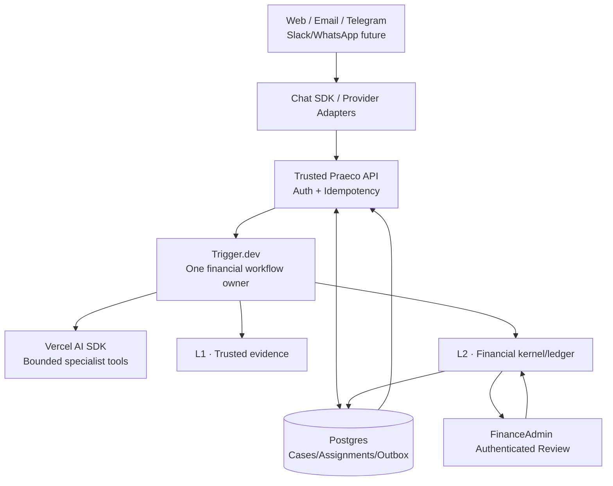

# L3 — Implementation Contract: Persistent Financial AI Teammate

**Status:** Proposed for Draft PR review; code not yet implemented
**Date:** 2026-10-17
**Authoritative references:** ADR-001–006, L1 v3.0.0 wire contract, L2 implementation contract and eight golden scenarios
**Build order:** P0 Trigger.dev + Vercel AI SDK, Web/Email with optional Telegram adapter; P1 full Chat SDK multichannel; P2 Eve, Pi Durable, Link and sandboxes only if justified.

## 1. Product acceptance

The user can send one synthetic invoice by web or email, receive a durable Assignment, inspect L1 verification and source references, submit the same case through L2's six deterministic gates, see its decision and simulated budget effect, and request authenticated human approval for the one threshold-eligible golden case. Telegram can query/status or submit the same case only after identity linking. All provider/payment identifiers are synthetic. No real payments.

A successful output uses `AUTHORIZED_SIMULATED`, `BLOCKED` or `PENDING_HUMAN_APPROVAL` **only as returned by L2**. L3 operational status is independently typed.

## 2. Architecture and authority



The SQL arrow from L2 is conceptual **L2-owned tables and transactions**, not a permission for L3 or model tools to write the ledger. No Eve runtime in this graph. Provider callback signatures, tenancy and access control are checked before any command.

## 3. Proposed TS domain interfaces

The following contracts are design proposals; verify package APIs against installed versions in the implementation PR. Avoid importing actual Trigger or Chat SDK types into domain packages.

```ts
type TenantId = string;
type AssignmentId = string;
type PayableCaseId = string;
type L1EnvelopeId = string;
type L2DecisionId = string;

type AssignmentState =
  | "QUEUED" | "RUNNING" | "WAITING_FOR_REVIEW"
  | "COMPLETED" | "FAILED_RECOVERABLE"
  | "FAILED_TERMINAL" | "CANCELLED";
type CaseLinkKind = "DOCUMENT" | "ERP_REFERENCE" | "CHANNEL_MESSAGE";

interface TrustedPrincipal {
  tenantId: TenantId;
  userId: string;
  roles: readonly string[];
  bindingRevision: string;
}
interface InboundMessageCommand {
  provider: "WEB" | "EMAIL" | "TELEGRAM" | "SLACK" | "WHATSAPP";
  installationId: string;
  providerEventId: string;
  providerThreadId: string;
  messageId: string;
  text?: string;
  attachmentRefs: readonly string[]; // server-fetched, authenticated and size checked
}
interface AgentPrincipal {
  tenantId: TenantId;
  principalId: string;
  workerVersionId: string;
  capabilityProfile: "VERA" | "KAEL" | "NOVA";
}
interface PayableCase {
  caseId: PayableCaseId;
  tenantId: TenantId;
  sourceLinks: readonly { kind: CaseLinkKind; refId: string }[];
  envelopeIds: readonly L1EnvelopeId[];
  accountingRefs: readonly string[]; // not authoritative financial values
  version: number;
}
interface Assignment {
  assignmentId: AssignmentId;
  tenantId: TenantId;
  caseId: PayableCaseId;
  agentPrincipalId: string;
  requestedByUserId: string;
  state: AssignmentState;
  version: number;
  runId?: string;
  l2DecisionId?: L2DecisionId;
  l2ApprovalRequestId?: string;
  triggerWaitToken?: string;
}
interface Checkpoint {
  checkpointId: string;
  assignmentId: AssignmentId;
  stage: "INGESTED" | "EVIDENCE_RESOLVED" | "L2_DECISION_RECORDED" | "AWAITING_REVIEW" | "FINISHED";
  inputRefs: readonly string[];
  outputRefs: readonly string[];
  runAttempt: number;
  recordedAt: string;
}
interface DomainEvent {
  eventId: string;
  tenantId: TenantId;
  aggregateId: string;
  eventType: string;
  commandId: string;
  causationId?: string;
  payloadRef?: string;
  occurredAt: string;
}
interface AssignmentPort {
  createOrLoad(input: InboundMessageCommand, principal: TrustedPrincipal): Promise<Assignment>;
  advance(input: { assignmentId: string; expectedVersion: number; next: AssignmentState; outputRefs: readonly string[] }): Promise<Assignment>;
  get(assignmentId: string, principal: TrustedPrincipal): Promise<Assignment>;
}
interface IngestSourceResult {
  pipelineRunId: string;
  sourceDisposition: "INVOICE_OR_UNCERTAIN" | "SUPPLEMENTAL_CONTEXT";
  envelopes: ReadonlyArray<{
    envelopeId: L1EnvelopeId;
    pipelineRunId: string;
    processingStatus: "READY_FOR_POLICY_EVALUATION" | "REVIEW_REQUIRED" | "REJECTED" | "PROCESSING_FAILED";
  }>;
}
interface EvidencePort {
  ingestSource(tenantId: string, sourceReference: string): Promise<IngestSourceResult>;
  loadReady(tenantId: string, envelopeId: L1EnvelopeId): Promise<unknown>;
}
// Imported from @praeco/financial-decision-kernel:
// FinancialDecisionRecord, FinancialEvaluation, PayableProposal
interface FinancialDecisionPort {
  decideAndCommit(
    input: {
      caseId: PayableCaseId;
      envelopeIds: readonly L1EnvelopeId[];
      idempotencyKey: string;
      agentGrantRef: string;
    },
    principal: TrustedPrincipal
  ): Promise<FinancialDecisionRecord>;
  getDecision(tenantId: string, decisionId: L2DecisionId): Promise<FinancialDecisionRecord | null>;
}
```

**Principal modeling note:** an agent's `AgentPrincipal` never substitutes for the trusted requesting principal. L2 receives a server-resolved scoped worker grant as well as an authenticated actor, using its independently defined types. `PayableCase` ID is advisory correlation, never a business duplicate key. Do not pass `unknown` trusted objects to financial evaluation without validated L1/L2 adapters.

## 4. Minimal persisted entities

- `agent_principals`: tenant, stable principal, version, enabled state.
- `channel_connections`: tenant, provider, installation, active state.
- `external_principal_bindings`: tenant, provider user ID, authenticated user, linking assurance/revocation.
- `inbound_event_receipts`: unique tenant+provider+installation+event ID, payload digest.
- `conversation_links`: channel+thread+case/assignment correlation (not authority).
- `payable_cases` and `case_sources`: one case may reference multiple L1 envelopes, accounting docs and supplemental sources.
- `assignments`, `assignment_runs`, `assignment_checkpoints`, `execution_events`.
- `command_receipts`: unique tenant+command scope+idempotency key; reject key reuse with mismatched payload digest.
- `outbox_events`: atomic dispatch to Trigger and outbound channel notifications; retryable delivery.
- **Never duplicate L2 ledger, grants, approval requests or budget effects in editable L3 tables.** Cache read-only decision summaries and IDs where needed.

For P0 use Postgres transactions with tenant-aware foreign keys and row/version guards. Separate chat-provider message state from assignment source of truth. Avoid retaining full sensitive invoice text, full bank identifiers or Link cards in conversational logs.

## 5. Required operations

1. `ingestChannelEvent`: validate provider webhook, tenant installation and replay ID, authenticate/link user, insert inbound receipt + command/outbox in one transaction.
2. `createOrLoadAssignment`: deduplicate by authenticated intent. A repeated inbound provider event returns the same assignment; a genuinely new command can deliberately create a new assignment referencing an existing case.
3. `runAssignment` in Trigger: read current SQL state, advance with version guard, invoke **bounded** AI SDK tools for classification/explanation, call L1, attach persisted refs, prefilter non-ready envelopes, checkpoint, call L2 through protected server-side port. Do not let a model author the trusted L1 reader return value or L2 principal context.
4. `awaitReview`: when L2 returns `PENDING_HUMAN_APPROVAL`, persist the L2 approval request ID and the Trigger wait token (`triggerWaitToken`) on the `Assignment` record, and enter `WAITING_FOR_REVIEW`. Deliver notifications through outbox. The authenticated approver action is handled by L2; once L2 commits its decision, the web approval API completes the Trigger wait token synchronously. Trigger wait tokens are wake-up signals, not proof of finance authorization.
5. `resumeAssignment`: read current L2 decision status, reread permissions, transition safely. Link and deliver channel updates.
6. `replayAssignment`: read historical events/source/decision refs without side effects. A new financial decision is a separate explicit command.
7. `notifyChannel`: redact, deduplicate by domain event + recipient + channel; delivery errors do not reverse financial state.

## 5.1 The Reconciler (Durable scheduled recovery)

A named **Reconciler** task runs as a Trigger.dev scheduled task (15–30s cadence, tenant-batched) owning three explicit recovery duties:
1. **Outbox draining:** Drain undispatched outbox rows for L3 events and call trusted L2 outbox drain port if configured.
2. **Approval observation:** Read L2 approval lifecycle state (derived expiry `createdAt + 24h` evaluated on read); for expired or resolved approvals, transition L3 assignments to `COMPLETED` and complete L3 waits. The Reconciler never writes or mutates L2 state directly.
3. **Wait completion fallback:** Completes suspended Trigger waitpoints if the synchronous completion call by the web API failed or timed out.

## 6. Specialist boundaries

- **Vera:** propose source ingestion and retrieve L1 status; cannot create READY output or approve invoices.
- **Kael:** ask for L2 read-only evaluation and explain stored gate checks; cannot override rules or issue authoritative decisions.
- **Nova:** submit eligible finance proposals via trusted server tool and read the delegated wallet inspector; cannot change vendor accounts, auto-grants, ledger or execute live payments.
- A P0 implementation may use one AI SDK agent with explicitly selected specialist tool sets. Multiple LLM conversations are not multiple durable assignment owners.
- Tool loops are bounded by steps, costs and deadlines. Prompt injection from email or invoice is never a command to change policy.

## 7. Vertical demo slices and acceptance

| Slice | Work product | Exit criterion |
| --- | --- | --- |
| A | SQL operational schema, identity/idempotency, fake channel adapter | duplicate inbound delivers one Assignment, tenant isolation |
| B | Trigger durable workflow, checkpoint/outbox, AI SDK bounded tool step | restart/retry resumes; cannot double-run L2 command |
| C | L1 ingest case/correlation via v3 reader and additive external provenance | source refs are verified; supplemental-only intake is not treated as READY |
| D | L2 typed adapter + decision reference + inspector | canonical 8 isolated financial outcomes from L2, no invented verdict |
| E | Authenticated human approval + durable wait/reconcile | stale/revoked/expired approval cannot authorize |
| F | Web + email delivery, linked Telegram status | same case ID visible across linked channels; delivery retry safe |
| G (later) | Slack/WhatsApp, Eve comparison, Link purchase wallet, sandbox | separate acceptance and security review |

**Boundary condition:** L2 is paused during L3 architecture closure. Real end-to-end Slice D/E must wait until L2 exists; before then use a deterministic *explicitly labeled* `FakeFinancialDecisionPort` strictly in integration tests and UI storyboards, **never** claim working end-to-end financial authorization from that fake.

## 8. Adversarial tests (mandatory)

- Cross-tenant provider events, case IDs, Slack installations or Telegram IDs cannot cross.
- Webhook replay, identical event concurrent arrival, missing auth and stale linking all fail safely.
- Concurrent Trigger task invocations cannot both advance an Assignment version.
- Agent cannot forge `TrustedPrincipal`, L1 READY invoice, L2 decision or FinanceAdmin approval via tool arguments.
- L1 source has two distinct document revisions; prior source reference cannot be silently replaced.
- Duplicate real-world payable arriving in email and ERP remains subject to L2 G2, not transport hash dedup.
- L2 timeout followed by Trigger retry returns same committed decision via its idempotency key.
- A pending approval survives restart and budget is not reserved in P0.
- Human response without verified web FinanceAdmin role cannot resolve approval.
- Revocation or policy changes after waiting are enforced on resolution.
- Notification delivery failure does not repeat financial commit.
- Any future Link card/merchant credentials stay out of AI tool outputs, chat transcripts and logs.
- No real payout, no conversion of `AUTHORIZED_SIMULATED` into `PAID`.

## 9. Runtime uncertainty and validation

Confirm exact versioned APIs for the installed AI SDK agent, Chat SDK adapters/store and Trigger.dev waits through a tiny proof of concept **after** docs review. Chat SDK support/credentials for WhatsApp and email must be empirically validated; fallback can be a direct provider adapter implementing the same `ChannelPort`. UI and backend may use different Node runtime constraints, and future Eve would require a new comparison/decision. Do not blindly add Eve to obtain features already supplied by AI SDK + Chat SDK + Trigger.

## 10. Delivery instruction

Implement in narrow Conventional-Commit PRs; do not change L1 wire v3.0.0, ADR-001/002/003, oracle outcomes or trusted finance semantics. Keep runtime package separation from L1/L2, synthetic datasets only. Production reliability/security require additional testing and review. This document is a proposal, not a claim that any L3 implementation exists.
