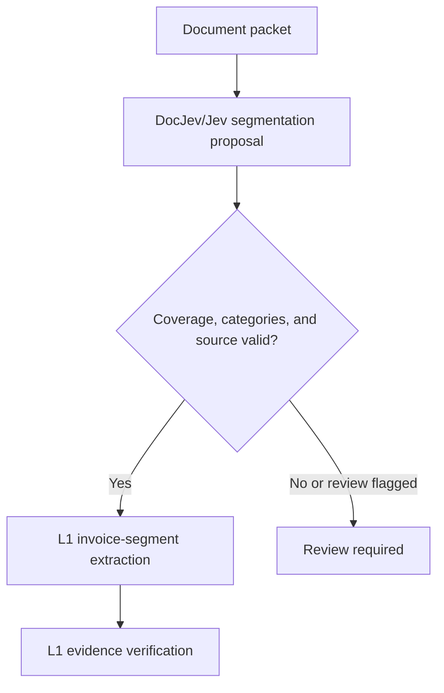

# Document classification adapter

Typed, fail-closed DocJev/Jev packet segmentation for Praeco. A packet may contain invoices, continuation pages, contracts, and supporting documents. Classification proposes their boundaries; it never grants evidence readiness or financial authority.



## Capabilities

- A bounded process bridge with timeout, output-size limits, and sanitized errors.
- Validation of contiguous page coverage, recognized categories, and source-hash bindings.
- `SegmentedLabelledTextExtractor`, an L1 extraction adapter preserving original page numbers and the existing wire contract.
- Conservative review handling for uncertain boundaries, conflicting restatements, and ambiguous multipage line items.

Invoice segments become extraction candidates. Contracts and supplemental pages remain context. Provider probabilities are not exposed as evidence confidence. The L3 workflow can select a specific invoice envelope from a multi-invoice packet.

## Use and test

From the repository root, build shared types before running the package tests:

```bash
npm run build
npm run test --workspace @praeco/document-classification-adapter
```

Tests use scripted provider responses and perform no hosted inference. Live classification requires the DocJev CLI, provider credentials, and the pinned configuration described in the [benchmark guide](../../docs/evaluation/docjev-splitting-benchmark.md).

The observed synthetic benchmark covers a small packet set; it is not a general extraction-accuracy guarantee.

## References

- [Public exports](src/index.ts)
- [L1 runtime integration](../../docs/architecture/l1-runtime.md)
- [Classification experiment](../../docs/evaluation/docjev-experiment.md)
- [Packet benchmark and provider revision](../../docs/evaluation/docjev-splitting-benchmark.md)
