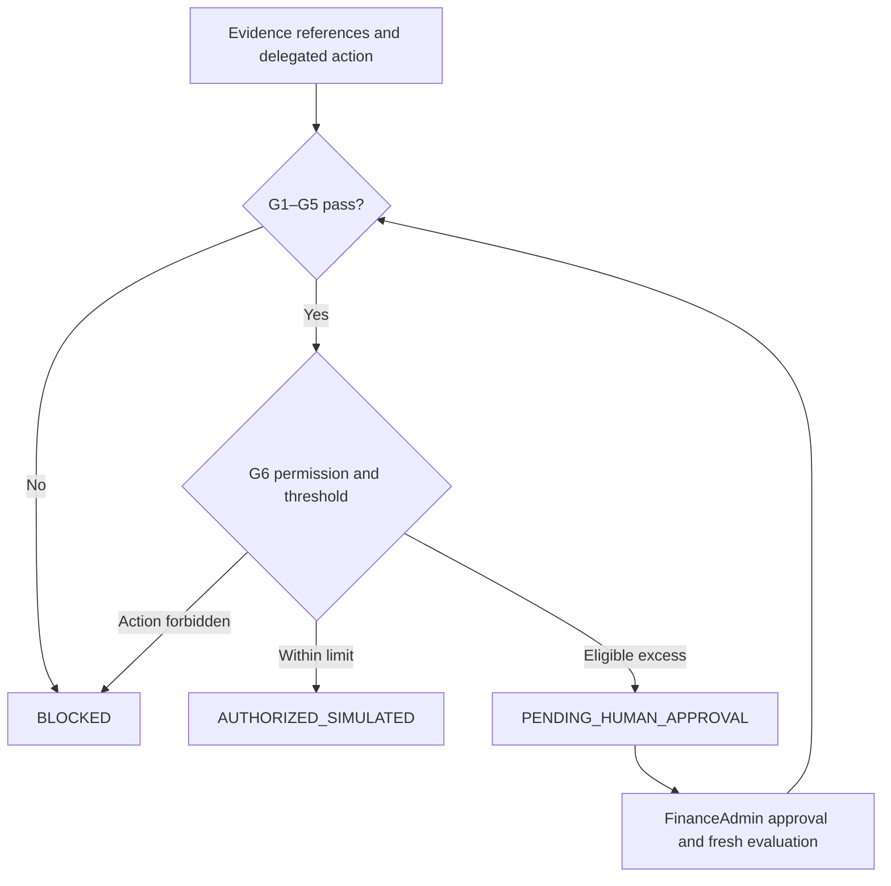

# Financial decision kernel · L2

Praeco's deterministic financial authority. L2 resolves evidence through a trusted L1 reader, applies company controls, and returns an auditable simulated decision.

## Six gates

| Gate | Check |
| --- | --- |
| G1 | Evidence integrity and critical fields |
| G2 | Duplicate or conflicting payable obligations |
| G3 | Allowlisted beneficiary and payment account |
| G4 | Contract terms and permitted variance |
| G5 | Available period budget |
| G6 | Delegated actions and auto-approval limits |



An approved exception applies only to the eligible threshold excess. Hard failures remain blocking. All arithmetic uses exact decimals; `AUTHORIZED_SIMULATED` never represents a bank transfer.

## Run

From the repository root:

```bash
npm run build
npm run test:l2
npm run l2:demo
```

The default demo uses an in-memory synthetic ledger. An optional [PostgreSQL commit adapter](../financial-store-sql/README.md) persists successful authorizations and recovers prior committed outcomes before current gate evaluation. Pending approvals, non-commit decisions, and trusted financial context remain in-memory.

## API and design

- [Public exports](src/index.ts)
- [Authorization service](src/service.ts)
- [Deterministic authorization](../../docs/adr/002-deterministic-financial-authorization.md)
- [Transactional ledger semantics](../../docs/adr/003-governed-wallets-transactional-ledger.md)
- [Implementation contract](../../docs/architecture/l2-implementation-contract.md)
